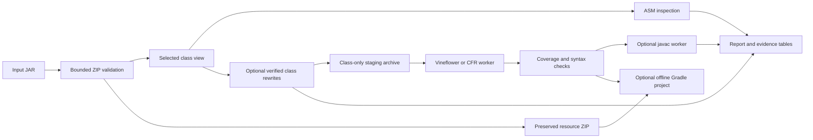

# Engine architecture

## Input and limits

The CLI verifies ZIP entry paths, duplicates, expanded sizes and CRCs before creating output. It reads classes individually. Resource bytes are copied into a separate ZIP. Nested JARs are preserved as resources. Spring Boot and WAR class roots are recognized. Their nested libraries are not opened automatically.

By default the archive limit is 256 MiB expanded, 16 MiB per entry, 40,000 entries and 128 MiB compressed. Static verification caps method instructions multiplied by frame slots, and exception-table density. Decompilers and javac run one worker at a time, with per-worker heap and wall-clock limits.

For a manifest-enabled multi-release JAR, the selected view uses the greatest eligible version per class. Use `--release N` to inspect another view. Source compilation defaults to the highest selected classfile release, with Java 8 as the minimum. `--source-release` overrides this target. Full compilation needs a JDK that supports the requested release.

## Rewrite transactions

The original engine matched adjacent literals only. Loads and joins hid values from the optimizer, and any exception table disabled branch simplification. The decompiler accepted a clean process exit even when source units were missing or contained error stubs.

`ConstantFlow` uses ASM's analyzer with a constant lattice for integer, long and string values. Joins keep a constant only when incoming facts agree. Exception edges take part in the analysis. Rewrites keep operand producers that could have side effects and remove adjacent literal or identical local loads only when safe. Integer and long overflow, narrowing, shift masking, and exceptions from division by zero are preserved. A jump with a known local value can bypass a dispatcher whose first two executable instructions load that local and switch on it. Unknown incoming edges still use the switch. Exception table cleanup removes exact shadowed entries and empty unreachable ranges while preserving active handlers and annotated entries.

`Bytecode` validates each candidate with ASM. A class receives up to six passes and retains its last verified bytes if verification or hierarchy resolution fails. Frame computation reads class headers from the selected archive view, staged dependencies, and JDK resources. It does not load those classes. Unchanged methods are copied from the original bytecode. Verification covers structural and basic data-flow constraints. Add a differential fixture for each semantically relevant rewrite.

## Static string recovery

On the first rewrite pass, `StringRecovery` finds candidate sites and uses `ConstantFlow` to recover input values and propagate proven text to later expressions. `Decoder` follows a concrete path through explicitly modeled bytecode in same-class private static helpers. It supports integer and long arithmetic, local byte, char and int arrays, loops with proven conditions, nested helpers, UTF-16 code units, and allowlisted JDK string and codec operations. Method handlers, synchronization, writes outside local allocations, arbitrary bootstraps, and other unsupported operations cause the candidate to be retained. Each path has instruction, allocation and depth limits. The class also has work and site limits.

Results known to be interned can become string constants. Fresh results are built from constant UTF-16 code units with `new String(char[])` to avoid interning new text. A fresh site can emit up to 512 code units and a class can emit up to 8192. Calls that return an argument's existing reference are retained. The rewrite keeps argument producers. Malformed codec input and byte sequences that require charset replacement are left to the original implementation. The concatenation evaluator accepts only exact JDK `StringConcatFactory` handles and recipes with supported primitive and string arguments. It never invokes an input bootstrap.

`report.txt` counts detected sites, sites with proven text, verified replacements, skips and failures. Proven text can overlap a skip or rollback. `string-rewrites.tsv` lists bounded diagnostics and text from verified replacements. The input-only `strings.tsv` continues to show literal codec evidence.

## Decompiler recovery

The source inventory uses inner class metadata to identify expected files and named declarations. A bounded javac worker parses the emitted files. Per-unit ranking considers missing declarations, syntax errors, backend failure markers and optional compilation diagnostics. JVM binary names, source filenames, and nested declarations all inform coverage. Auto mode can retry just the incomplete roots with CFR, using the staged archive to resolve related classes. Compare mode and compilation-driven fallback use the full archive. Selected units are parsed again and recompiled when requested before replacing the primary source tree.

Compilation distinguishes missing packages and modules from unresolved symbols and other compiler errors. A missing name can reflect a missing library or a decompiler defect. The tool never guesses Maven coordinates or retrieves dependencies.

## Evidence

- `report.txt` records the archive, selected view, bytecode findings, rewrites and verification.
- `class-issues.tsv` and `rewrite-issues.tsv` record malformed classes, skipped rewrites and rollbacks.
- `mappings.tsv` records suggested names with original owner, member and descriptor.
- `references.tsv` records selected class-to-class references from declarations and instructions.
- `hierarchy.tsv` records declared superclass and interface edges. `calls.tsv` records symbolic method call sites and dispatch kinds. Virtual and interface calls retain their declared targets.
- `strings.tsv` contains decoded literal payloads. Treat it as potentially sensitive.
- `bootstraps.tsv` and `wrappers.tsv` identify bootstrap references and forwarding shapes without executing target code.
- `minecraft.tsv` records plugin and mod descriptors and matched entrypoints.
- `*-diagnostics.tsv`, `syntax-*.tsv` and `javac-*.tsv` hold bounded worker evidence.
- `source-quality.tsv` records expected units, diagnostics and backend selections.
- `comparison.tsv` compares file coverage and hashes across decompilers.

The detector can identify manifest declarations or vendor-named resources for tools such as Allatori, Zelix, Stringer, DashO, ProGuard, R8, or yGuard. These indicators can be forged or bundled accidentally. Generic control-flow and API-use counts are clues, and ordinary code can exhibit them.

## Limits and priorities

General control-flow unflattening, mutable static lookup tables, cross-class decoder paths, arbitrary bootstrap execution, and automatic class/member renaming are outside the current engine. Local debug identifiers can be repaired while preserving binary member and parameter names. The tool preserves nested JARs as resources. Java file counts can differ from class counts because inner classes often appear in an outer source file.

`--project` exports an offline Java Gradle build with conventional source and resource directories. It preserves original descriptors and copies supplied staged libraries. Repacking invalidates original signatures, which remain in `resources.zip`. Loader-specific Gradle configuration, mapping namespaces, and original build scripts cannot be inferred reliably from bytecode.

## Benchmark

Run `./gradlew benchmark --args=5000` to measure inspection, verification and staging on a generated archive. Each JVM warms up once and records three iterations. On Windows with JDK 25, a 768 MiB heap and four active processors, two JVMs per version measured median times of 1.752 s for 0.2.0 and 1.717 s for 0.3.0. The runs overlapped in timing. This fixture does not measure custom decoder loops or decompiler work. A baseline JFR profile identified ASM analyzer traversal and class parsing among the sampled hot methods.
