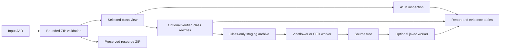

# Engine architecture

## Input and limits

The CLI verifies ZIP entry paths, duplicates, expanded sizes and CRCs before creating output. It reads classes individually. Resource bytes are copied into a separate ZIP. Nested JARs are preserved as resources. Spring Boot and WAR class roots are recognized. Their nested libraries are not opened automatically.

By default the archive limit is 256 MiB expanded, 16 MiB per entry, 40,000 entries and 128 MiB compressed. Static verification caps method instructions multiplied by frame slots, and exception-table density. Decompilers and javac run one worker at a time, with per-worker heap and wall-clock limits.

For a manifest-enabled multi-release JAR, the selected view uses the greatest eligible version per class. Use `--release N` to inspect a different view. Source compilation targets releases 8 through 21.

## Rewrite transactions

`Rewrites` recognizes adjacent constant integer operands. Producer removal cannot cross a line, label or frame node. Folding uses JVM overflow, shift, comparison and narrowing semantics and leaves division by zero intact. Constant branch and switch rewrites run only in version 51+ methods without exception handlers. Affected methods are rescanned for unreachable instructions.

`Bytecode` validates the original class and emitted candidate with ASM. For control-flow changes it computes frames using selected class headers and JDK class resources. Unavailable hierarchy keeps the original bytecode. These checks do not validate all JVM linkage or behavioral equivalence. Add a differential fixture for each new transformation.

## Evidence

- `report.txt` records the archive, selected view, bytecode findings, rewrites and verification.
- `class-issues.tsv` and `rewrite-issues.tsv` record malformed classes, skipped rewrites and rollbacks.
- `mappings.tsv` records suggested names with original owner, member and descriptor.
- `references.tsv` records selected class-to-class references from declarations and instructions.
- `strings.tsv` contains decoded literal UTF-8 payloads. Treat it as potentially sensitive.
- `minecraft.tsv` records descriptors and matched entrypoints.
- `*-diagnostics.tsv` and `javac-*.tsv` hold bounded worker diagnostics.
- `comparison.tsv` compares file coverage and hashes across decompilers.

The detector can identify manifest declarations or vendor-named resources for tools such as Allatori, Zelix, Stringer, DashO, ProGuard, R8, or yGuard. These indicators can be forged or bundled accidentally. Generic control-flow and API-use counts are clues, and ordinary code can exhibit them.

## Limits and priorities

General control-flow unflattening, proprietary string decryption, invokedynamic bootstrap resolution, exception-handler recovery, malformed class repair and automatic cross-class member or package renaming remain open. The tool does not recurse into nested JARs. Java source file counts can differ from class counts because inner classes often appear in an outer source file. The class-only archive can also be opened in an offline bytecode tool such as Recaf.

Next priorities are exception-aware constant propagation, dependency-aware frame verification, reference-safe source renaming, license-compatible vendor fingerprints and broader performance measurements.
